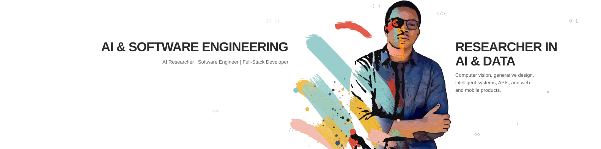

<h1 align="center"><strong>Joy Lukoji</strong></h1>

  

  
  

  <a href="#about-me">About</a> · <a href="#featured-projects">Featured projects</a> · <a href="#stack-and-skills">Skills</a> · <a href="#professional-work">Professional work</a> · <a href="#contact">Contact</a>

---

##  About me

Independent AI researcher and full-stack developer. I work across computer vision, generative design, intelligent systems, APIs, and web and mobile products. I care about software that is correct, measurable, and useful in the real world.

##  Stack & skills

<table>
  <tr>
    <td width="50%" valign="top">
      <h3>Languages & backend</h3>
      

        
        
        
        
        
        
      

    </td>
    <td width="50%" valign="top">
      <h3>AI & data</h3>
      

        
        
        
        
        
        
      

    </td>
  </tr>
  <tr>
    <td width="50%" valign="top">
      <h3>Frontend & mobile</h3>
      

        
        
        
        
        
      

    </td>
    <td width="50%" valign="top">
      <h3>Tools & infrastructure</h3>
      

        
        
        
        
        
      

    </td>
  </tr>
</table>

##  Featured projects

<table>
  <tr>
    <td width="50%" valign="top">
      <h3><a href="https://github.com/joeylukoji/archlux">archlux</a></h3>
      
AI · Computational design

      
Repairs AI-generated floor plans into geometrically valid designs while preserving daylight.

    </td>
    <td width="50%" valign="top">
      <h3><a href="https://github.com/joeylukoji/A-AI">A-AI</a></h3>
      
Generative design · 3D

      
Turns a natural-language brief into an editable 2D floor plan and a Blender 3D model.

    </td>
  </tr>
  <tr>
    <td width="50%" valign="top">
      <h3><a href="https://github.com/joeylukoji/CanopyOS">CanopyOS</a></h3>
      
Computer vision · Climate

      
Uses image segmentation to ground greening recommendations in a real place.

    </td>
    <td width="50%" valign="top">
      <h3><a href="https://github.com/joeylukoji/PanlyackErp">PanlyackErp</a></h3>
      
ERP · PostgreSQL

      
Turns a reviewed invoice into inventory, journal, and cash operations in one PostgreSQL transaction.

    </td>
  </tr>
</table>

##  Professional work

### Université Protestante de Lubumbashi (UPL)

Production software used by university faculties, staff, and students.

| Project | Description | Stack |
|---|---|---|
| [UPL website & UPL Média](https://github.com/joeylukoji/website) | University website and multilingual CMS for events, publications, projects, calendars, and faculty-managed content. | Laravel · PHP · MySQL · Redis |
| [UPL community platform](https://github.com/joeylukoji/upl_community_backend) | Backend for community chat, knowledge sharing, and information feeds. | Python |
| [UPL university site](https://github.com/joeylukoji/upl-universit--site) · [live demo](https://upl-universit-site.vercel.app) | Earlier version of the public university site. | HTML · CSS · JavaScript |

> These repositories are private because they belong to the institution. Code walkthroughs are available on request.

##  More public work

[IA-detection-post-operation](https://github.com/joeylukoji/IA-detection-post-operation) · [Qwen_mcp](https://github.com/joeylukoji/Qwen_mcp) · [Mesh_ai_project](https://github.com/joeylukoji/Mesh_ai_project) · [Ransom_war](https://github.com/joeylukoji/Ransom_war) · [Frigate-NVR-](https://github.com/joeylukoji/Frigate-NVR-) · [hexagone-connect](https://github.com/joeylukoji/hexagone-connect)

##  DEV.to badges

  
  

##  Other private work

AI for video analysis and healthcare, VR surgical training, AI accounting, security-testing tools, marketplaces, education and ERP platforms, e-commerce, booking and visa services, NFC business cards, and client websites. Some projects are available to discuss on request.

---

##  Contact

  Open to research collaborations, freelance work, and AI/software consulting.  
  
  

